  

  <a href="https://linkedin.com/in/huzaifa-mulla-859ba2196"><b>LinkedIn</b></a> &nbsp;·&nbsp;
  <a href="mailto:huzaifa4g@gmail.com"><b>Email</b></a> &nbsp;·&nbsp;

  B.Tech CSE, NSUT Delhi (2026) · Delhi NCR · <b>open to SDE-1, AI Engineer, full-stack and founding-engineer roles</b>

## about

I build AI-backed products end to end, from the backend and LLM integration to the mobile and web clients.

- At **Tilantra** I work on **CapsuleHub**, an AI context-persistence engine (Swift + Node.js) with a multi-provider LLM layer (OpenAI and Anthropic) and a live Chrome extension used by real users.
- My B.Tech thesis is on **neuro-fuzzy face super-resolution**: an ANFIS and CNN hybrid with a fully differentiable Sugeno inference layer in PyTorch, benchmarked on CelebA and LFW.
- 10+ freelance full-stack deliveries, and 4 years of competitive programming.

## shipped

| Project | What it is | Stack |
|---|---|---|
| [**CapsuleHub**](https://chromewebstore.google.com/detail/capsule-hub-by-tilantra/ngeoeefidomejcdhiecidpaalfoekjbh) | Production AI context management. Keeps versioned conversation state in sync across devices and LLM providers. Live on the Chrome Web Store. | Swift · Node.js · PostgreSQL · OpenAI · Anthropic · AWS |
| [**Neuro-Fuzzy Face SR**](https://drive.google.com/file/d/1L6GdNSFtrvqUpXAm0zL22TWCUa-FREAi/view) | B.Tech thesis. Novel ANFIS + CNN architecture for face super-resolution, with differentiable Sugeno inference via custom PyTorch autograd. | PyTorch · ANFIS · OpenCV |
| [**PeerFact**](https://github.com/v9pt/peerfact) | Claim-verification platform with append-only evidence graphs, trust-score ranking and a WebSocket room per claim. ([demo](https://drive.google.com/file/d/1lTX6wFgRf3CDgMrNANOlf_y2p6UNYWc5/view?usp=sharing)) | React · Node.js · TypeScript · MongoDB |
| [**NGO Platform**](https://github.com/v9pt/ngo-platform) | Donation platform with a government-schemes finder for women. | See repo |
| **Smart Retail Checkout** | Edge computer-vision checkout on a Raspberry Pi 4. YOLOv5 exported to INT8 TFLite, under 100 ms inference, billing decoupled over MQTT. | YOLOv5 · TFLite · OpenCV · MQTT |

<!-- TODO: add trip-concierge-pro and vera-ai-challenge here once their READMEs are done. -->

## stack

**Languages** &nbsp; Python · TypeScript · JavaScript · Swift · C++ · Java · C · SQL 
**Backend** &nbsp; FastAPI · Node.js / Express · Flask 
**Frontend and mobile** &nbsp; React · Next.js · SwiftUI / iOS SDK · React Native 
**Data** &nbsp; PostgreSQL · MongoDB · Redis · MySQL 
**AI / ML** &nbsp; PyTorch · OpenAI and Anthropic APIs · OpenCV · TFLite · scikit-learn 
**Infra** &nbsp; AWS · Docker · GitHub Actions · Nginx

## competitive programming

Codeforces **Specialist** (1448) · CodeChef **4★** · HackerRank **5★**

DP, graph algorithms, segment trees and combinatorics. This is the kind of thing I like:

  

<i>open to roles in 2026 · New Delhi / Gurugram · huzaifa4g@gmail.com</i>

